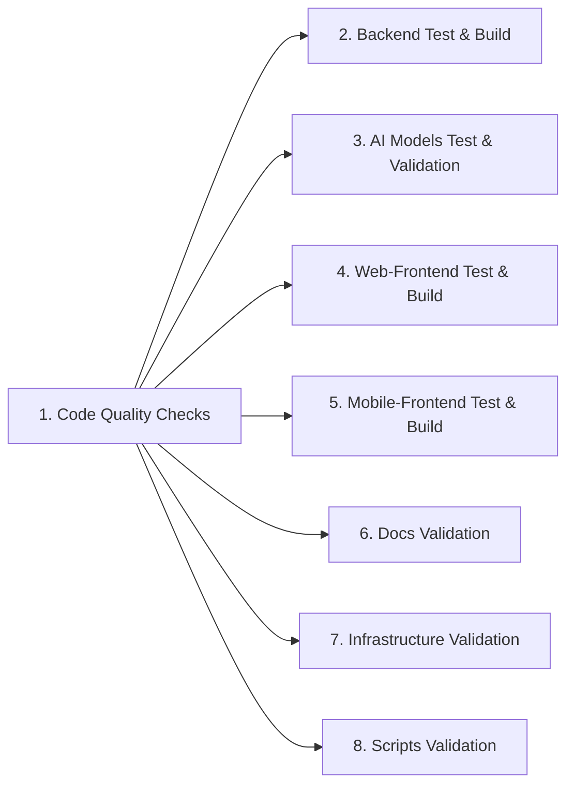

# CI/CD Pipeline

QuantumAlpha uses a single GitHub Actions workflow, [`cicd.yml`](../workflows/cicd.yml), to validate every change. It contains eight jobs: one formatting gate followed by seven jobs that run in parallel and cover the backend, AI engine, web app, mobile app, documentation, infrastructure, and shell scripts. See the [root README](../../README.md) for the project overview.

## Triggers

| Trigger             | Scope                          | Purpose                                         |
| :------------------ | :----------------------------- | :---------------------------------------------- |
| `push`              | `main` and `develop`           | Validate every commit that lands on a main line |
| `pull_request`      | Targeting `main` and `develop` | Block merges that fail any check                |
| `workflow_dispatch` | Any branch, run manually       | On-demand execution                             |

## Pipeline Overview



| #   | Job ID                        | Display name                 | Depends on     | Timeout    | Runtime                        |
| :-- | :---------------------------- | :--------------------------- | :------------- | :--------- | :----------------------------- |
| 1   | `code_quality`                | Code Quality Checks          | None           | Default    | Python 3.11, Node 20           |
| 2   | `backend_test_build`          | Backend Test & Build         | `code_quality` | Default    | Python 3.11, Docker            |
| 3   | `ai_models_test`              | AI Models Test & Validation  | `code_quality` | 45 minutes | Python 3.11                    |
| 4   | `web-frontend_test_and_build` | Web-Frontend Test & Build    | `code_quality` | Default    | Node 20                        |
| 5   | `mobile_frontend`             | Mobile-Frontend Test & Build | `code_quality` | Default    | Node 20                        |
| 6   | `docs_validation`             | Docs Validation              | `code_quality` | 10 minutes | Node 20, Python 3.11           |
| 7   | `infrastructure_validation`   | Infrastructure Validation    | `code_quality` | 30 minutes | Python 3.11, Terraform, Docker |
| 8   | `scripts_validation`          | Scripts Validation           | `code_quality` | 10 minutes | Python 3.11                    |

If Code Quality Checks fails, none of the other seven jobs start, so any formatting deviation blocks the whole pipeline.

## Job 1: Code Quality Checks

| Stage                 | Control area          | Detail                                                                                           |
| :-------------------- | :-------------------- | :----------------------------------------------------------------------------------------------- |
| Source integrity      | Checkout              | Full repository checkout with complete Git history (`fetch-depth: 0`)                            |
| Python runtime        | Standardization       | Python 3.11 with `autoflake` and `black==25.11.0` installed                                      |
| Python hygiene        | Unused code           | `autoflake --remove-all-unused-imports --remove-unused-variables --recursive --check .`          |
| Python style          | Formatting            | `black . --check` across the whole repository                                                    |
| Node runtime          | Standardization       | Node.js 20 with `prettier` and `prettier-plugin-solidity` installed globally                     |
| Repository formatting | Prettier              | Checks `js`, `jsx`, `ts`, `tsx`, `json`, `html`, `css`, `md`, `sol`, `yml`, and `yaml` files     |
| Compliance gate       | Fail on any deviation | Both checks are non-mutating, so a formatting difference fails the job instead of rewriting code |

## Job 2: Backend Test & Build

| Stage                | Control area         | Detail                                                                                                                         |
| :------------------- | :------------------- | :----------------------------------------------------------------------------------------------------------------------------- |
| Environment          | Dependencies         | Python 3.11 with pip caching keyed on `code/backend/requirements.txt`; installs `pytest`, `pytest-cov`, and `pytest-asyncio`   |
| Tests                | Backend suite        | `pytest tests/ --tb=short --strict-markers -v --cov=. --cov-report=xml:coverage.xml` from `code/backend`                       |
| Reporting            | Coverage             | Uploads `backend-coverage-report` (`coverage.xml`) on every run, kept for 30 days                                              |
| Image build          | API image            | Builds `code/backend/Dockerfile` (runtime target) as `quantumalpha-api:ci`                                                     |
| Image build          | Shared service image | Builds `code/Dockerfile.service` (runtime target) as `quantumalpha-service:ci`, used by the data, risk, and execution services |
| Image build          | AI engine image      | Builds `code/ai_models/Dockerfile` with `INSTALL_ML=false` as `quantumalpha-ai-engine:ci`                                      |
| Build performance    | Layer cache          | Docker Buildx with a separate GitHub Actions cache scope per image                                                             |
| Container security   | Non-root check       | Fails if any of the three images runs as user id 0                                                                             |
| Runtime verification | Smoke tests          | Starts each container and polls `/health` (up to 30 attempts, 2 seconds apart), then checks the response body                  |
| Cleanup              | Containers           | Always removes the `quantumalpha-ci-*` containers; prints container logs when a smoke test fails                               |

Smoke test targets:

| Service           | Image                    | Container port | `APP_MODULE`                        | Expected health response |
| :---------------- | :----------------------- | :------------- | :---------------------------------- | :----------------------- |
| API gateway       | `quantumalpha-api`       | 8000           | Image default                       | `"status":"ok"`          |
| Data service      | `quantumalpha-service`   | 8080           | `backend.data_service.app:app`      | `"status":"ok"`          |
| Risk service      | `quantumalpha-service`   | 8080           | `backend.risk_service.app:app`      | `"status":"ok"`          |
| Execution service | `quantumalpha-service`   | 8080           | `backend.execution_service.app:app` | `"status":"ok"`          |
| AI engine         | `quantumalpha-ai-engine` | 8080           | Image default                       | `"status":"healthy"`     |

## Job 3: AI Models Test & Validation

| Stage             | Control area        | Detail                                                                                                                                                                     |
| :---------------- | :------------------ | :------------------------------------------------------------------------------------------------------------------------------------------------------------------------- |
| Environment       | Runtime flags       | `PYTHONPATH` points at `code/`, `TF_CPP_MIN_LOG_LEVEL=2` quiets TensorFlow, and `CUDA_VISIBLE_DEVICES` is empty so no GPU is used                                          |
| Dependencies      | Full ML stack       | Installs `requirements-ml.txt` (TensorFlow, PyTorch, Stable-Baselines3) so the `deep` and `rl` tests run instead of skipping                                               |
| Static validation | Byte-compile        | `python -m compileall -q code/ai_models` over all sources and tests                                                                                                        |
| Static validation | Import verification | Imports 15 sub-packages and modules (`api.app`, `api.container`, `core.settings`, `data.client`, `models.factory`, `rl.agents`, and others) and prints the package version |
| Tests             | AI engine suite     | `pytest tests/` from `code/ai_models` with `--cov=ai_models`, a terminal report that skips fully covered files, and an XML report                                          |
| Reporting         | Coverage            | Uploads `ai-models-coverage-report` on every run (missing file tolerated), kept for 30 days                                                                                |

## Job 4: Web-Frontend Test & Build

| Stage        | Control area   | Detail                                                                     |
| :----------- | :------------- | :------------------------------------------------------------------------- |
| Environment  | Node runtime   | Node.js 20 with npm caching keyed on `web-frontend/package-lock.json`      |
| Dependencies | Locked install | `npm ci --legacy-peer-deps` in `web-frontend`                              |
| Tests        | Jest           | `CI=true npm test`                                                         |
| Build        | Production     | `CI=false npm run build` (Vite)                                            |
| Reporting    | Artifact       | Uploads `frontend-dist` (`web-frontend/dist/`) on success, kept for 7 days |

## Job 5: Mobile-Frontend Test & Build

| Stage        | Control area   | Detail                                                                                 |
| :----------- | :------------- | :------------------------------------------------------------------------------------- |
| Environment  | Node runtime   | Node.js 20 with npm caching keyed on `mobile-frontend/package-lock.json`               |
| Dependencies | Locked install | `npm ci --legacy-peer-deps` in `mobile-frontend`                                       |
| Tests        | Jest           | `npm run test:ci` (coverage, no watch mode, forced exit)                               |
| Build        | Android bundle | `CI=false npm run build:bundle` produces the React Native JavaScript bundle and assets |
| Reporting    | Artifact       | Uploads `mobile-android-bundle` (`mobile-frontend/dist/`) on success, kept for 7 days  |

## Job 6: Docs Validation

| Stage             | Control area             | Detail                                                                                                                                                                                                                 |
| :---------------- | :----------------------- | :--------------------------------------------------------------------------------------------------------------------------------------------------------------------------------------------------------------------- |
| Markdown linting  | markdownlint-cli2 0.24.0 | Lints `docs/**/*.md` and the root `README.md`. Line length (MD013) is left to Prettier, duplicate headings are only errors between siblings, and a short list of inline HTML elements is allowed for badges and images |
| Link integrity    | lychee 0.24.2 (offline)  | Checks internal links and heading anchors in `docs/**/*.md`, `README.md`, `infrastructure/README.md`, and `.github/readme/README.md`                                                                                   |
| Code samples      | Syntax validation        | Parses fenced `python` blocks with `ast`, checks `bash`, `sh`, and `shell` blocks with `bash -n`, and parses `json` blocks, across `docs/` and the root `README.md`                                                    |
| Script docs       | Consistency              | Every `scripts/*.sh` must be documented in `docs/CLI.md`, and every script documented there must exist                                                                                                                 |
| Docs index        | Consistency              | Every page in `docs/` and `docs/examples/` must be linked from `docs/README.md`                                                                                                                                        |
| Repository weight | Size warning             | Warns (does not fail) about files in `docs/` larger than 5 MB                                                                                                                                                          |
| External links    | Advisory                 | Checks external links in `docs/` and `README.md` with 2 retries and a 20 second timeout, accepting `2xx` and `429`; marked `continue-on-error`, so it never fails the job                                              |

## Job 7: Infrastructure Validation

Tool versions are pinned in the job environment: Kubernetes schemas 1.28.0, kubeconform 0.8.0, kustomize 5.4.3, hadolint 2.15.1, Terraform 1.6.6, and TFLint v0.65.0. Python tooling comes from `infrastructure/requirements-ci.txt`.

| Stage      | Control area         | Detail                                                                                                                                                                                                                                                                                                              |
| :--------- | :------------------- | :------------------------------------------------------------------------------------------------------------------------------------------------------------------------------------------------------------------------------------------------------------------------------------------------------------------ |
| Terraform  | Formatting           | `terraform fmt -check -recursive -diff` in `infrastructure/terraform`                                                                                                                                                                                                                                               |
| Terraform  | Validation           | `terraform init -backend=false` and `terraform validate` in `environments/dev`, which is the root module and pulls in every module under `modules/`                                                                                                                                                                 |
| Terraform  | Toggle wiring        | Advisory: warns about any `enable_*` variable that is declared in a module but never read                                                                                                                                                                                                                           |
| Terraform  | Linting              | `tflint --recursive --minimum-failure-severity=error` fails on errors and prints warnings                                                                                                                                                                                                                           |
| Kubernetes | Base manifests       | `kustomize build base` rendered offline, then `kubeconform -strict` against the 1.28.0 schemas plus the CRDs catalog                                                                                                                                                                                                |
| Kubernetes | Platform manifests   | Same render and schema check for `platform`, plus a check that the only Namespaces are `monitoring` and `security-scanning` and that every namespaced resource lives in one                                                                                                                                         |
| Kubernetes | Environment overlays | Renders and validates `dev`, `staging`, and `prod`. Each must contain exactly one Namespace (`quantumalpha-dev`, `quantumalpha-staging`, `quantumalpha`) holding all namespaced resources, and the ConfigMap hosts `DB_HOST`, `REDIS_HOST`, `INFLUXDB_URL`, and `KAFKA_BOOTSTRAP_SERVERS` must match a real Service |
| YAML       | yamllint             | Lints every tracked YAML file under `infrastructure/` with `infrastructure/.yamllint`                                                                                                                                                                                                                               |
| Docker     | Compose validation   | Copies `.env.example` to `.env` and `.env.local`, then runs `docker compose config --quiet`                                                                                                                                                                                                                         |
| Docker     | Dockerfile linting   | `hadolint --failure-threshold error` on `infrastructure/docker/*/Dockerfile` and `web-frontend/Dockerfile`                                                                                                                                                                                                          |
| Docker     | Frontend image build | Builds `web-frontend/Dockerfile` (not pushed) with a GitHub Actions layer cache; the backend and AI images are built in jobs 2 and 3                                                                                                                                                                                |
| Secrets    | Hard-coded secrets   | Scans Terraform, Kubernetes, database, services, monitoring, security, Docker, and logging files for password, secret, API key, and private key patterns, ignoring `.example` files and placeholders                                                                                                                |

## Job 8: Scripts Validation

| Stage        | Control area      | Detail                                                                                                                                                                                                                                     |
| :----------- | :---------------- | :----------------------------------------------------------------------------------------------------------------------------------------------------------------------------------------------------------------------------------------- |
| Static check | ShellCheck        | `shellcheck --severity=warning` on every tracked `*.sh` file; warnings and errors fail the job (`shellcheck-py==0.11.0.1`)                                                                                                                 |
| Static check | Stricter findings | Advisory: `shellcheck --severity=info`, marked `continue-on-error`                                                                                                                                                                         |
| Syntax       | `bash -n`         | Parses every tracked shell script and requires a `bash` or `sh` shebang on the first line                                                                                                                                                  |
| Repository   | Executable bit    | Every tracked `*.sh` file must be mode `100755` in Git; the error message shows the `git update-index --chmod=+x` fix                                                                                                                      |
| Runtime      | `--help` smoke    | Runs `--help` with a 30 second timeout on `backup`, `deploy`, `k8s_deploy`, `lint`, `monitor_setup`, `restore`, `run_tests`, `setup_env`, `start_dev`, `start_service`, and `stop_services`, and requires exit code 0 with a usage message |
| Safety       | Clean tree        | Fails if any `--help` run modifies the working tree. `setup.sh`, `start.sh`, and `stop.sh` are excluded because they have no real `--help` handler                                                                                         |

## Artifacts

| Artifact                    | Produced by                  | Contents                      | Retention |
| :-------------------------- | :--------------------------- | :---------------------------- | :-------- |
| `backend-coverage-report`   | Backend Test & Build         | `code/backend/coverage.xml`   | 30 days   |
| `ai-models-coverage-report` | AI Models Test & Validation  | `code/ai_models/coverage.xml` | 30 days   |
| `frontend-dist`             | Web-Frontend Test & Build    | `web-frontend/dist/`          | 7 days    |
| `mobile-android-bundle`     | Mobile-Frontend Test & Build | `mobile-frontend/dist/`       | 7 days    |

## Advisory Steps

These steps report problems without failing the pipeline (`continue-on-error: true`):

| Job                       | Step                               |
| :------------------------ | :--------------------------------- |
| Docs Validation           | External link check                |
| Infrastructure Validation | `enable_*` toggle wiring check     |
| Scripts Validation        | ShellCheck stricter style findings |

## Reproducing the Checks Locally

```bash
# Job 1: formatting (from the repository root)
pip install autoflake black==25.11.0
autoflake --remove-all-unused-imports --remove-unused-variables --recursive --check .
black . --check
npm install -g prettier prettier-plugin-solidity
prettier --plugin="$(npm root -g)/prettier-plugin-solidity/dist/index.js" \
  --check "**/*.{js,jsx,ts,tsx,json,html,css,md,sol,yml,yaml}"

# Job 2: backend tests (from code/backend)
pytest tests/ --tb=short --strict-markers --cov=.

# Job 3: AI engine tests (from code/ai_models, with requirements-ml.txt installed)
PYTHONPATH=.. pytest tests/ --cov=ai_models

# Jobs 4 and 5: frontends
(cd web-frontend && npm ci --legacy-peer-deps && CI=true npm test && npm run build)
(cd mobile-frontend && npm ci --legacy-peer-deps && npm run test:ci && npm run build:bundle)

# Job 8: shell scripts
git ls-files -z '*.sh' | xargs -0 shellcheck --severity=warning
```
