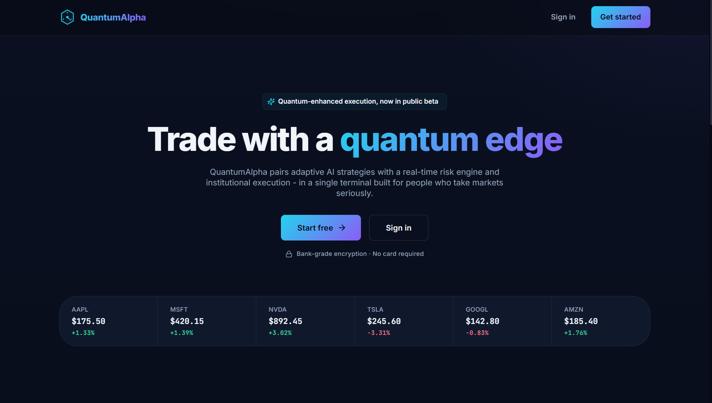
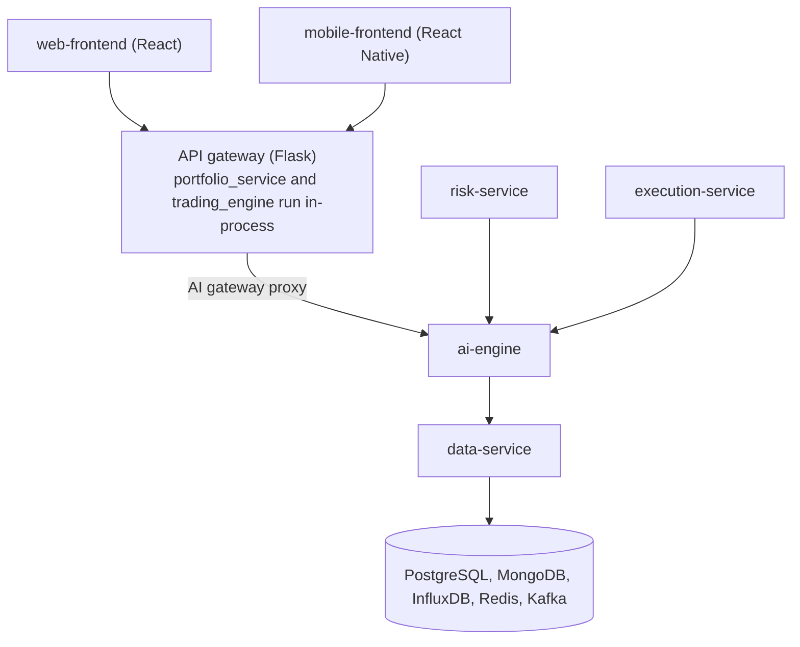

# QuantumAlpha

[](https://github.com/quantsingularity/QuantumAlpha/actions/workflows/cicd.yml)
[](LICENSE)


QuantumAlpha is an AI-driven quantitative trading platform built as a set of independently deployable Flask services (API gateway, data, AI engine, risk, and execution), paired with a React web dashboard and a React Native mobile app. The AI engine trains, versions, and serves forecasting models and reinforcement-learning agents through its own API, and the risk and execution services call it over HTTP.

<div align="center">
  
</div>

## Table of Contents

- [Overview](#overview)
- [Architecture](#architecture)
- [Project Structure](#project-structure)
- [Feature Status](#feature-status)
- [Technology Stack](#technology-stack)
- [Installation and Setup](#installation-and-setup)
- [Running the Stack](#running-the-stack)
- [API Surface](#api-surface)
- [Testing](#testing)
- [CI/CD Pipeline](#cicd-pipeline)
- [Documentation](#documentation)
- [Contributing](#contributing)
- [License](#license)

## Overview

| Topic              | Summary                                                                                                                                                 |
| :----------------- | :------------------------------------------------------------------------------------------------------------------------------------------------------ |
| Deployment model   | Data, AI engine, risk, and execution run as separate Flask apps. Portfolio management and the trading engine run in-process inside the API gateway.     |
| Shared image       | `code/Dockerfile.service` builds one image for the data, risk, and execution services; the `APP_MODULE` build arg selects the service.                  |
| Model lifecycle    | Create, train, validate (walk-forward), tune, evaluate, version, predict, ensemble, and monitor, all served by the AI engine API.                       |
| Supported models   | LSTM, GRU, CNN, and Transformer (TensorFlow/Keras); Ridge, Random Forest, and Gradient Boosting (scikit-learn); tabular Q-learning, PPO, DQN, A2C, SAC. |
| Service-to-service | The risk service calls the AI engine for AI-adjusted portfolio valuations. The execution service calls it to place trades directly from a prediction.   |

## Architecture



| Service           | Local port | Responsibilities                                                      |
| :---------------- | :--------- | :-------------------------------------------------------------------- |
| API gateway       | 8080       | Auth, portfolio, trading, admin, and system routes                    |
| Data service      | 8081       | Market data, alternative data, feature engineering                    |
| AI engine         | 8082       | Model lifecycle, forecasting, signals, RL agents, drift monitoring    |
| Risk service      | 8083       | VaR, Expected Shortfall, stress testing, position sizing, risk alerts |
| Execution service | 8084       | Order management, execution strategies, broker adapter                |
| Web dashboard     | 3000       | React UI (`npm run dev` and Docker Compose both use 3000)             |

See [docs/ARCHITECTURE.md](docs/ARCHITECTURE.md) for detail.

## Project Structure

| Path              | Purpose                                                                                         |
| :---------------- | :---------------------------------------------------------------------------------------------- |
| `code/backend`    | API gateway, the data, risk, and execution services, in-process modules, shared code, and tests |
| `code/ai_models`  | AI engine: models, training, inference, registry, RL, monitoring, and tests                     |
| `web-frontend`    | React (Vite) dashboard                                                                          |
| `mobile-frontend` | React Native app, with an `e2e/` directory for end-to-end tests                                 |
| `infrastructure`  | Docker, Kubernetes, Terraform, monitoring, and security configuration                           |
| `scripts`         | Setup, run, test, deploy, backup, and restore scripts                                           |
| `docs`            | Project documentation                                                                           |
| `.github`         | CI/CD workflow and its documentation                                                            |

## Feature Status

| Component                | Status and details                                                                                                                                                                                                 |
| :----------------------- | :----------------------------------------------------------------------------------------------------------------------------------------------------------------------------------------------------------------- |
| **API gateway**          | Flask app exposing `/api/auth`, `/api/portfolio`, `/api/trade`, `/api/admin`, `/api/system`, and `/health`, plus an `ai_gateway` blueprint that proxies requests to the AI engine.                                 |
| **Data service**         | Market and alternative data backed by PostgreSQL, InfluxDB (time series), MongoDB (alternative data), and Redis.                                                                                                   |
| **AI engine**            | Full model lifecycle for deep, classical, and RL models. Routes are Flask blueprints (system, models, predictions, signals, RL) tested through the same HTTP layer. Also generates signals and monitors drift.     |
| **Risk service**         | VaR, Expected Shortfall, Sharpe ratio, stress tests (historical, Monte Carlo, sensitivity, custom), position sizing, risk alerts, and an online-learning risk updater. Inputs are schema-validated on every route. |
| **Execution service**    | Order management, execution strategies, and a generic HTTP broker adapter against a configurable `broker.url`.                                                                                                     |
| **Messaging**            | Kafka producer and consumer classes (`confluent-kafka`) in the shared `common` module.                                                                                                                             |
| **Auth**                 | JWT sessions via Flask-JWT-Extended, with MFA-related user fields.                                                                                                                                                 |
| **Compliance/analytics** | In-process modules (not separately deployed) for compliance monitoring, regulatory reporting, performance attribution, and factor analysis.                                                                        |
| **Web dashboard**        | React (JavaScript) with Redux Toolkit, Material-UI, and Recharts.                                                                                                                                                  |
| **Mobile app**           | React Native (TypeScript and JavaScript) with React Navigation, Zustand, and `react-native-chart-kit`.                                                                                                             |

## Technology Stack

| Area             | Technology                                                                                                                                                         |
| :--------------- | :----------------------------------------------------------------------------------------------------------------------------------------------------------------- |
| Backend services | Python 3.11, Flask, Gunicorn                                                                                                                                       |
| Auth             | Flask-JWT-Extended, MFA-related user model fields                                                                                                                  |
| Data layer       | PostgreSQL, MongoDB, InfluxDB, Redis                                                                                                                               |
| Messaging        | Kafka (confluent-kafka)                                                                                                                                            |
| ML / RL          | TensorFlow/Keras (LSTM, GRU, CNN, Transformer), scikit-learn (Ridge, Random Forest, Gradient Boosting), Stable-Baselines3 (PPO, DQN, A2C, SAC), tabular Q-learning |
| Web frontend     | React 18, Redux Toolkit, Material-UI, Recharts, Vite                                                                                                               |
| Mobile frontend  | React Native, TypeScript and JavaScript, React Navigation, Zustand, react-native-chart-kit                                                                         |
| Infrastructure   | Docker, Docker Compose, Kubernetes (Kustomize), Terraform                                                                                                          |
| Monitoring       | Prometheus, Grafana, Elasticsearch, Kibana                                                                                                                         |
| CI/CD            | GitHub Actions                                                                                                                                                     |
| Testing          | pytest (backend and AI engine), Jest (web and mobile)                                                                                                              |

## Installation and Setup

Prerequisites: Python 3.11+, Node.js 20+, and Docker (for the full multi-service stack).

```bash
git clone https://github.com/quantsingularity/QuantumAlpha.git
cd QuantumAlpha

# Backend (dependencies shared by all Flask services)
cd code/backend
python -m venv .venv && source .venv/bin/activate
pip install -r requirements.txt

# AI engine (core dependencies plus TensorFlow, PyTorch, Stable-Baselines3)
pip install -r ../ai_models/requirements-ml.txt

# Web frontend
cd ../../web-frontend
npm install

# Mobile frontend
cd ../mobile-frontend
npm install
```

For an automated setup:

```bash
git clone https://github.com/quantsingularity/QuantumAlpha.git
cd QuantumAlpha
./scripts/setup_env.sh
docker-compose -f infrastructure/docker-compose.yml up
```

Environment-specific instructions are in [docs/INSTALLATION.md](docs/INSTALLATION.md).

## Running the Stack

```bash
# Full stack: Postgres, MongoDB, InfluxDB, Redis, Kafka, and every service
docker-compose -f infrastructure/docker-compose.yml up

# Or run services individually (from code/, venv active)
APP_MODULE=backend.data_service.app:app python -m flask run --port 8081
APP_MODULE=backend.risk_service.app:app python -m flask run --port 8083
APP_MODULE=backend.execution_service.app:app python -m flask run --port 8084
DATA_SERVICE_URL=http://localhost:8081 python -m ai_models   # serves http://0.0.0.0:8082
PORT=8080 python -m backend.api.main                         # API gateway on http://0.0.0.0:8080

# Web dashboard (from web-frontend)
npm run dev

# Mobile app (from mobile-frontend)
npm start
```

See [docs/USAGE.md](docs/USAGE.md) and [docs/CONFIGURATION.md](docs/CONFIGURATION.md).

## API Surface

Every service exposes its own `/health` check. Full request and response shapes are in [docs/API.md](docs/API.md).

| Service           | Area            | Endpoints                                                                                                                                                                                    |
| :---------------- | :-------------- | :------------------------------------------------------------------------------------------------------------------------------------------------------------------------------------------- |
| API gateway       | Auth            | `/api/auth/{register,login,logout,me}`                                                                                                                                                       |
| API gateway       | Portfolio       | `/api/portfolio`, `/api/portfolio/positions`                                                                                                                                                 |
| API gateway       | Trading         | `/api/trade/order`, `/api/trade/orders`                                                                                                                                                      |
| API gateway       | Admin and ops   | `/api/admin/users`, `/api/system/status`                                                                                                                                                     |
| Data service      | Data            | `/api/market-data/{symbol}`, `/api/alternative-data/{source}`, `/api/features/{symbol}`, `/api/data-sources`                                                                                 |
| AI engine         | Catalog, models | `/api/catalog`, `/api/models`, `/api/models/{id}`, `/api/models/{id}/{train,evaluate,validate,tune,versions,explain}`, `/api/models/{id}/versions/{v}` and `/promote`                        |
| AI engine         | Monitoring      | `/api/models/{id}/{performance,reconcile,drift,health}`, `/ready`, `/metrics`                                                                                                                |
| AI engine         | Predictions     | `/api/predict`, `/api/predict/batch`, `/api/predict/ensemble`, `/api/predict/{model_id}/{symbol}`, `/api/models/{id}/predictions/{symbol}`, `/api/train-model`                               |
| AI engine         | Signals, jobs   | `/api/generate-signals`, `/api/signals`, `/api/jobs`                                                                                                                                         |
| AI engine         | RL              | `/api/rl/algorithms`, `/api/rl/models`, `/api/rl/models/{id}`, `/api/rl/train`, `/api/rl/act`                                                                                                |
| Risk service      | Risk            | `/api/risk-metrics`, `/api/stress-test`, `/api/calculate-position`, `/api/portfolio-risk`, `/api/risk-alerts`, `/api/portfolio-value-prediction` (calls the AI engine)                       |
| Execution service | Execution       | `/api/orders`, `/api/orders/{id}/cancel`, `/api/execution-strategies`, `/api/brokers`, `/api/brokers/{id}/accounts`, `/api/trade-from-signal`, `/api/trade-from-model` (calls the AI engine) |

## Testing

| Suite     | Directory         | Run locally                   |
| :-------- | :---------------- | :---------------------------- |
| Backend   | `code/backend`    | `pytest tests/`               |
| AI engine | `code/ai_models`  | `PYTHONPATH=.. pytest tests/` |
| Web       | `web-frontend`    | `npm test`                    |
| Mobile    | `mobile-frontend` | `npm run test:ci`             |

Run each command from the directory shown. All four suites run in CI, and the backend and AI engine jobs upload coverage reports. The AI engine `deep` and `rl` tests need `requirements-ml.txt` installed. See [CI/CD Pipeline](#cicd-pipeline).

## CI/CD Pipeline

GitHub Actions (`.github/workflows/cicd.yml`) runs on pushes and pull requests to `main` and `develop`, and on manual dispatch. Every job after the first depends on **Code Quality Checks**, so the other seven run in parallel once formatting passes.

| #   | Job                          | Depends on          | What it does                                                                                                                                                                 |
| :-- | :--------------------------- | :------------------ | :--------------------------------------------------------------------------------------------------------------------------------------------------------------------------- |
| 1   | Code Quality Checks          | None                | `autoflake` and `black --check` on Python; repository-wide Prettier check (JS, TS, JSON, HTML, CSS, Markdown, Solidity, YAML)                                                |
| 2   | Backend Test & Build         | Code Quality Checks | Runs pytest with coverage, builds the API, shared service, and AI engine images, checks they run as non-root, and smoke tests `/health` on all five services                 |
| 3   | AI Models Test & Validation  | Code Quality Checks | Installs the ML dependencies, byte-compiles sources, verifies sub-package imports, and runs the AI engine pytest suite (including `deep` and `rl` tests) with coverage       |
| 4   | Web-Frontend Test & Build    | Code Quality Checks | `npm ci`, Jest tests, production Vite build, and upload of the `frontend-dist` artifact                                                                                      |
| 5   | Mobile-Frontend Test & Build | Code Quality Checks | `npm ci`, Jest tests (`test:ci`), Android JS bundle build, and upload of the `mobile-android-bundle` artifact                                                                |
| 6   | Docs Validation              | Code Quality Checks | markdownlint, offline link and anchor checks, syntax checks for Python, Bash, and JSON code blocks, docs and scripts consistency checks, and an advisory external link check |
| 7   | Infrastructure Validation    | Code Quality Checks | Terraform fmt, validate, and TFLint; Kubernetes manifests via kustomize and kubeconform; yamllint; Compose config; hadolint; frontend image build; hard-coded secret scan    |
| 8   | Scripts Validation           | Code Quality Checks | ShellCheck, syntax and shebang checks, executable-bit checks, and `--help` smoke tests for the CLI scripts                                                                   |

Coverage reports (`backend-coverage-report`, `ai-models-coverage-report`) are kept for 30 days, and build artifacts for 7 days. The step-by-step breakdown of each job is in [.github/readme/README.md](.github/readme/README.md).

## Documentation

| Document                                                                                 | Contents                               |
| :--------------------------------------------------------------------------------------- | :------------------------------------- |
| [docs/README.md](docs/README.md)                                                         | Documentation index                    |
| [docs/ARCHITECTURE.md](docs/ARCHITECTURE.md)                                             | System architecture                    |
| [docs/API.md](docs/API.md)                                                               | REST API reference                     |
| [docs/INSTALLATION.md](docs/INSTALLATION.md)                                             | Setup for all components               |
| [docs/CONFIGURATION.md](docs/CONFIGURATION.md)                                           | Environment variables and config       |
| [docs/USAGE.md](docs/USAGE.md)                                                           | Running and using the platform         |
| [docs/CLI.md](docs/CLI.md)                                                               | Helper scripts reference               |
| [docs/FEATURE_MATRIX.md](docs/FEATURE_MATRIX.md)                                         | Feature status, implemented vs planned |
| [docs/ML_MODEL_PERFORMANCE.md](docs/ML_MODEL_PERFORMANCE.md)                             | Model evaluation methodology           |
| [docs/TROUBLESHOOTING.md](docs/TROUBLESHOOTING.md)                                       | Common issues and fixes                |
| [docs/CONTRIBUTING.md](docs/CONTRIBUTING.md)                                             | Contribution guide                     |
| [docs/examples/ai-engine-example.md](docs/examples/ai-engine-example.md)                 | Worked example: AI engine              |
| [docs/examples/execution-service-example.md](docs/examples/execution-service-example.md) | Worked example: execution service      |
| [docs/examples/risk-management-example.md](docs/examples/risk-management-example.md)     | Worked example: risk management        |

## Contributing

See [docs/CONTRIBUTING.md](docs/CONTRIBUTING.md).

## License

This project is licensed under the MIT License. See the [LICENSE](LICENSE) file for details.
